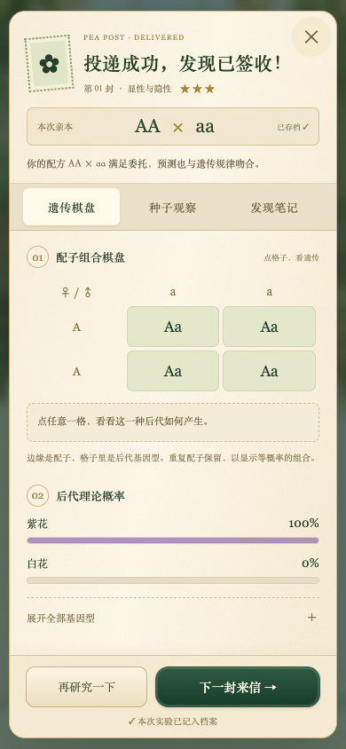

# 豌豆邮局 · The Pea Post

高中生物必修二「遗传因子的发现」学习游戏。把孟德尔遗传规律变成温室来信、亲本搭配、概率预测与跨代育种。

仓库同时保留最新版网页 App 与原网页版，均提供独立离线 HTML。App 使用植物绘本插画、纸质信封、布面发现手册和邮票收藏界面。

<p>
  
</p>

## 直接游玩

**在线开始：<https://meiosis7.github.io/pea-post/>**

原网页版：<https://meiosis7.github.io/pea-post/web/>

下载仓库后，用现代浏览器打开以下文件：

- **最新版 App**：[豌豆邮局App-离线版.html](app/豌豆邮局App-离线版.html)。图片、样式和游戏逻辑均已嵌入，无需联网。
- **原网页版**：[豌豆邮局.html](豌豆邮局.html)。保留原有桌面网页布局。

GitHub 文件页面本身不会运行游戏，请下载 HTML 后再打开。

## 内容与玩法

- **四季来信**：16 封递进委托，从显性与隐性、分离定律、测交，逐步进入双因子自由组合与概率分析。
- **亲本实验**：选择基因型、预测后代概率、授粉验证；点击配子组合棋盘解释每种后代的形成。
- **种子观察**：比较理论概率与真实抽样，追加种植，理解小样本随机波动。
- **育种温室**：跨代留种、出售收获、完成 6 份订单、扩建育苗床，收集 9 种基因型与谱系。
- **配子工坊**：亲手拆分与组合等位基因，完成 3 种配子收集挑战。
- **发现手册**：48 颗发现之星、16 枚知识邮票、8 项荣誉、田野笔记与实验档案。

游戏采用理想化孟德尔遗传模型：完全显性、等概率受精、后代生活力相同；双因子实验假设两对基因独立遗传。

## 本机预览与构建

需要 Node.js；本机预览需要 Python 3。

```sh
npm ci
npm test
npm run build:app
npm run serve
```

启动服务后访问：

- App：<http://127.0.0.1:64312/app/>
- 原网页版：<http://127.0.0.1:64312/dist/>

该本机地址只在服务运行时可用。

```sh
npm run build        # 构建原网页版
npm run build:app    # 构建 App 脚本包与独立离线 HTML
npm run test:app-ui  # 验证 App 界面与交互，需先启动本机服务
```

浏览器测试使用 Playwright，当前浏览器路径为 macOS 的 Google Chrome。其他系统可在 tests/ 中调整 executablePath。

## 网页 App 与存档

`app/` 是可独立托管的静态网页目录。通过 HTTPS 或 localhost 打开时，支持 Service Worker 缓存与添加到主屏幕；这是网页 App，不是原生 APK / IPA 安装包。

进度保存在本机浏览器中，设置页可以导出和导入存档。不同浏览器、网址以及独立 HTML 可能使用不同的存储空间，迁移时请先导出备份。App 与原网页版使用独立存档键。

## 目录

| 目录或文件 | 用途 |
| --- | --- |
| `app/` | 最新 App 源码、插画、启动入口与离线成品 |
| `dist/` | 保留的原网页版预览 |
| 根目录 JS / CSS / HTML | 原网页版源码与离线成品 |
| `tests/` | 遗传模型、存档、温室、关卡与浏览器交互测试 |
| `docs/` | 界面截图与原网页版说明 |

App 中的位图插画由 AI 生成，相关素材说明位于 `app/assets/generation-manifest-v2.json`。

## 验证记录

本版本已完成 36 项模型与存档测试、16 封来信全流程、手机布局检查、离线打开、连续授粉与启动加载失败恢复测试。

## 自动部署

推送到 `main` 后，GitHub Actions 会验证遗传模型与存档，构建 App，然后部署到 GitHub Pages。最新 App 位于站点首页，原网页版保留在 `/web/`。

`npm run build:pages` 可以在本机构建同样的 `_site/` 发布目录。
